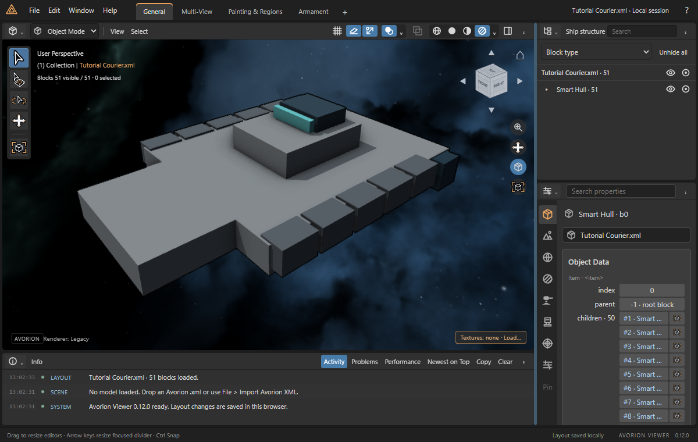

# Areas

An area is one rectangle of the editor layout. Its editor selector changes the type of editor shown there.

## Resize

Drag a divider between areas. Hold **Ctrl** to snap where supported; double-click a divider to equalize the split. Focus a divider and use arrow keys for keyboard resizing, with **Shift** for a larger step. Minimum editor sizes can limit movement.

## Split and join

Right-click an area header or border, or use its area menu. A vertical split creates side-by-side areas; a horizontal split creates stacked areas. Join only an eligible neighbor, choosing the editor to keep. Restore a maximized area first.

Corner grips offer a second method: drag inward to split or toward an eligible sibling to join. Press **Escape** before completing the operation to cancel it.

## Swap editors

Use the neighbor-swap command in an area menu, or the configured corner-drag modifier. Swapping exchanges editor contents without importing another model.

## Maximize and focus

**Ctrl+Space** maximizes the hovered editor by default. Use the same shortcut, **Escape**, or **Back to Previous** to restore it. **Ctrl+Shift+Space** toggles Focus Mode in this checkout; menu commands remain available if the browser reserves a shortcut.

## Watch a resize

:::{raw} html
<figure class="media-example gif-example" data-animation>

<button type="button" aria-pressed="false" hidden>Play animation</button>Static image shown.

<figcaption class="media-caption">Actual app capture: the vertical divider is dragged to resize adjacent areas. The ship model does not change. Animation plays only when requested.</figcaption>
</figure>
:::
