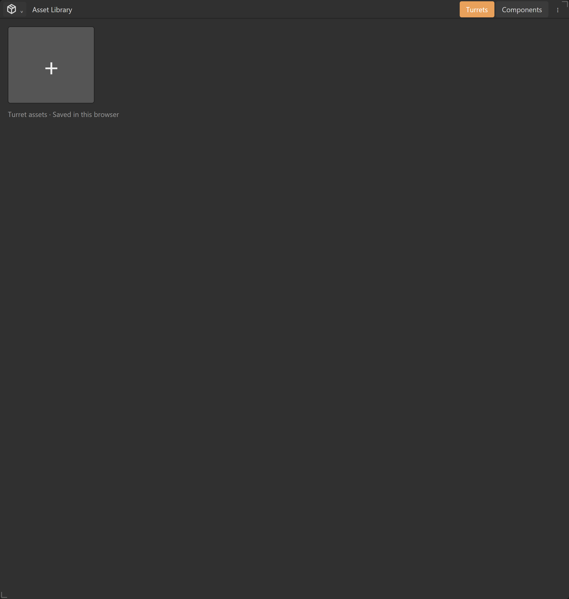
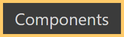
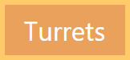
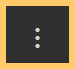
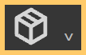

# Use the asset libraries

## Turrets and Components

<!-- inline-capture:assets-show-components-in-the-asset-library-69 -->
:::{raw} html
<figure class="section-control-image"><figcaption>Show components in the Asset Library</figcaption></figure>
:::
<!-- end-inline-capture -->

<!-- inline-capture:assets-show-turrets-in-the-asset-library-68 -->
:::{raw} html
<figure class="section-control-image"><figcaption>Show turrets in the Asset Library</figcaption></figure>
:::
<!-- end-inline-capture -->

An asset is a reusable imported design. A mounted copy is an instance of that design attached to a ship.

Open an **Asset Library** editor, then choose **Turrets** or **Components** in its header. These are separate libraries.

Press **Space** over a suitable non-text editing area to open the **Quick Asset Library**. It leaves the viewport available for placement. Use its close button or **Escape** to close it.

## Import and organize assets

<!-- inline-capture:assets-area-options-70 -->
:::{raw} html
<figure class="section-control-image"><figcaption>Area options</figcaption></figure>
:::
<!-- end-inline-capture -->

<!-- inline-capture:assets-editor-type-67 -->
:::{raw} html
<figure class="section-control-image"><figcaption>Editor type</figcaption></figure>
:::
<!-- end-inline-capture -->

Use the **+** tile to import the appropriate XML design. Importing the same design can select the existing asset instead of making a duplicate.

Click a tile to select it. Double-click the tile to open its asset workspace. Double-click the name, or focus it and press **F2** or **Enter**, to rename it. Press Enter to save the name or Escape to cancel.

The component library also supplies search and folder filtering. Use **Library Files** to import or export component packs as JSON. XML designs enter through the **+** tile, not the pack importer.

**Export Shown Components** exports the current filtered list. Clear search and folder filters first when you want a pack of the entire component library.

The remove control deletes the library entry. Existing mounted copies retain their saved geometry. Keep the original design XML and available pack backups before removing assets.

## Save an asset workspace

An asset workspace is a separate editing window inside the app. Its changes remain drafts until you choose **Save asset**.

**Cancel** leaves the library asset unchanged. If you try to close a changed draft, the app can ask whether to discard it.

Editing a library asset does not automatically update every mounted copy. Inspect the instance update controls before changing an existing layout.

## Manage the source of a mounted turret

With a turret selected, open **Properties > Turrets > Selected Turret**. The library source controls show the mounted and library revisions where available.

- **Edit library asset** opens its source design.
- **Save as new asset** makes a separate library asset from the mounted copy.
- **Update from library** previews an update to that mounted design.

Read the update summary and warnings before **Apply**. Compatible instance settings can be retained, but source changes can affect the result.

If the source is unavailable, the mounted copy remains usable. This does not restore the missing original file on disk.

## Folders & saved models

### Choose asset folders

Open **File > Asset folders…**. The dialog has separate rows for **Textures**, **XML models**, and **Other assets**.

Choose the folder that belongs to each row. A remembered folder is a permitted location that the app can read again. It is different from a downloaded backup.

In supported Chrome and Edge configurations, the browser can remember the folder. On a later visit, it can reconnect automatically or ask you to select **Reconnect folders**.

If a folder moves or permission is lost, reconnect it or choose it again.

### Use the one-time picker

Browsers can refuse to remember protected folders. This can affect game folders under Program Files and ship folders under AppData.

If the folder chooser reports **Can't open this folder**:

1. Return to **File > Asset folders…**.
2. Select **Use one-time picker…** when offered.
3. Choose the folder again.

The app can keep copies of ship files and loaded textures in browser storage. The browser does not need to retain permission to the original folder for those copies.

A one-time ship-folder copy does not update itself when you save new ships in the game. Use **Refresh…** and choose the folder again to read its current contents.

Browsers without remembered-folder support use a one-time picker.

### Find a ship in the model browser

After you choose an XML model folder, use its model browser to:

- Search by filename or subfolder.
- Examine block count, file size, and date.
- Mark **Favorites**.
- Reopen a file from **Recent**.

Double-click a model, or select it and press **Enter**, to open it. Large folders can take time to scan on their first use.

**Forget** stops remembering the folder. For a saved folder copy, it removes that browser copy. It does not remove the files on your disk.

### Understand where files go

Opening a file reads it into the app. Saving a ship or export produces a browser download. Find downloaded files through your browser's download list or configured download folder.

The app does not turn browser storage into a backup folder. Download the files you need before clearing site data, changing browsers, or changing devices.
