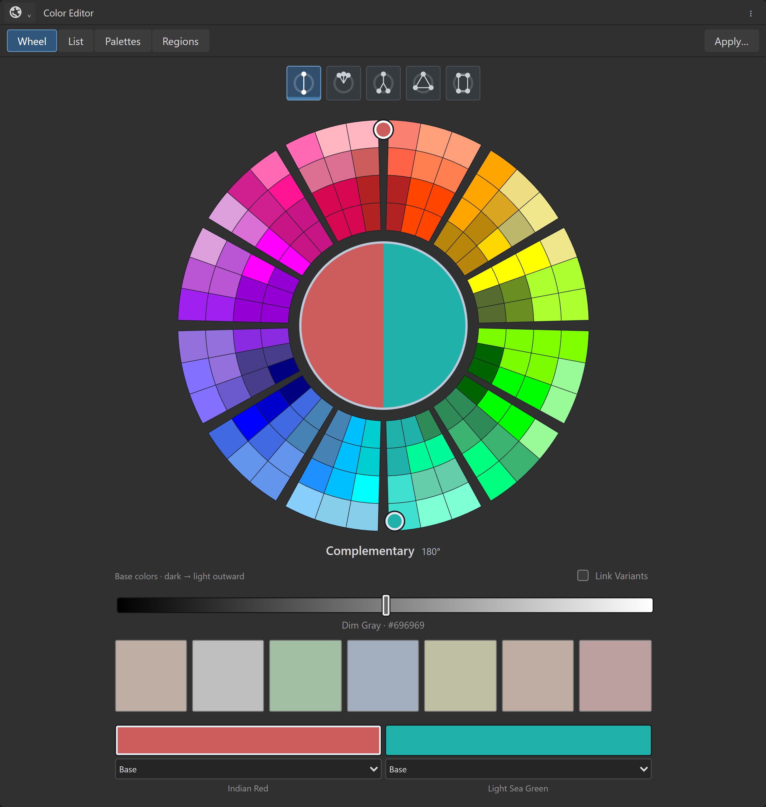
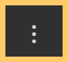

# Use colors, palettes, and regions

## Open the Color Editor

<!-- inline-capture:colors-area-options-66 -->
:::{raw} html
<figure class="section-control-image"><figcaption>Area options</figcaption></figure>
:::
<!-- end-inline-capture -->

<!-- inline-capture:colors-editor-type-65 -->
:::{raw} html
<figure class="section-control-image"><figcaption>Editor type</figcaption></figure>
:::
<!-- end-inline-capture -->

Choose **Window > Open Color Workshop**, use the **Painting & Regions** workspace, or change an area's editor type to **Color Editor**.

The editor has **Wheel**, **List**, **Palettes**, and **Regions** tabs. Open **Apply…** for channel, target, and paint history actions.

## Choose a named color

The palette contains 407 named Avorion colors: 132 bases and 275 existing variants. The app uses the supplied game color values.

Use Wheel for a visual choice. Colors run from darker to lighter outward through hue families. Some sparse areas repeat an existing color. Use List to reach all colors, including neutrals and browns.

List search can find names, RGB values, hexadecimal values, and source rows. A source row identifies a row in the supplied palette data; it is not a verified game item ID.

Choose a base, then an available variant. The app does not invent missing variants. Its grayscale control selects an existing gray rather than making an arbitrary new RGB color.

## Build a harmony

Harmony controls suggest combinations such as complementary, analogous, split complementary, triadic, and tetradic colors. Suggestions select existing Avorion colors.

Each suggested family has its own variant choice. **Link Variants** follows the primary variant where that family contains it. It does not create a missing variant in another family.

Browsing colors or changing harmony prepares a choice. It does not repaint the ship.

To apply a color:

1. Select blocks, or choose a region.
2. Choose the color and channel.
3. Open **Apply…**.
4. Check the target.
5. Select **Apply to Selected** or **Apply to Region**.

## Save and edit a palette

In Palettes, choose the colors and enter a name in the palette creation controls. Select **Create Palette**.

Saved palettes remain in this browser. Activate one with its activation control to use it in the paint toolbar and radial menu.

Use a saved palette's **⋮** menu to:

- **Edit Name**.
- Add a color with **+ Color**.
- Remove a color with **- Color**.
- **Delete Palette**.

A palette must retain at least one color and can contain up to 32 colors. Choosing a saved swatch changes the active paint color.

## Make a named region

A region is a reusable named group of blocks for the currently loaded model.

1. Select the blocks in the viewport or Outliner.
2. Open Color Editor > **Regions**.
3. Select **+ New from Selection**.
4. Enter a useful name, such as “Engine trim.”
5. Choose a display color if needed.

The region's display color is a highlight color. It is not automatically applied as paint.

Use **Off**, **Highlight**, or **Isolate** to control its display. Use **Select** or **Frame** to work with its blocks.

## Change region membership

| Action | Result |
|---|---|
| **Edit in Viewport** | Click or box-select to add region members; hold Ctrl to remove them |
| **Done Editing** or Escape | Ends viewport membership editing |
| **Add Selected** | Adds the current selection |
| **Remove Selected** | Removes selected members |
| **Replace with Selection** | Replaces the region's membership |
| **Grow** | Adds touching blocks, including hidden blocks |
| Region **Undo** | Reverses the latest region change |
| **Delete Region** | Removes the named group after its confirmation |

Viewport region editing changes membership without replacing the ordinary block selection. Regions can overlap.

A region cannot become empty through membership editing. Delete it if you no longer need it. Grow uses block bounds, so inspect its result around slopes and hollow shapes.

If you change visibility elsewhere, isolation can become a highlight instead of overriding the new visibility choice.

Regions persist in Model Projects and browser recovery. Use **Replace Source XML…** to review region transfers onto a revised model.
