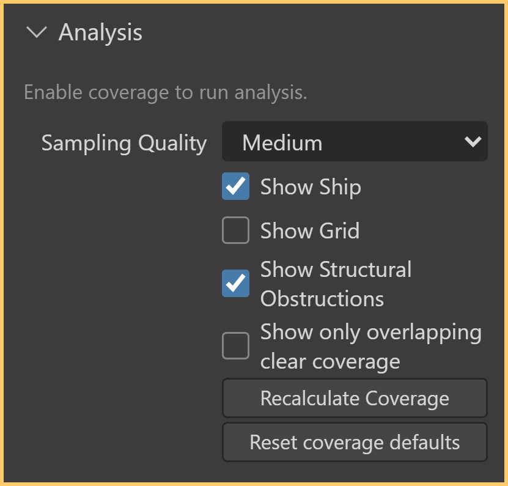
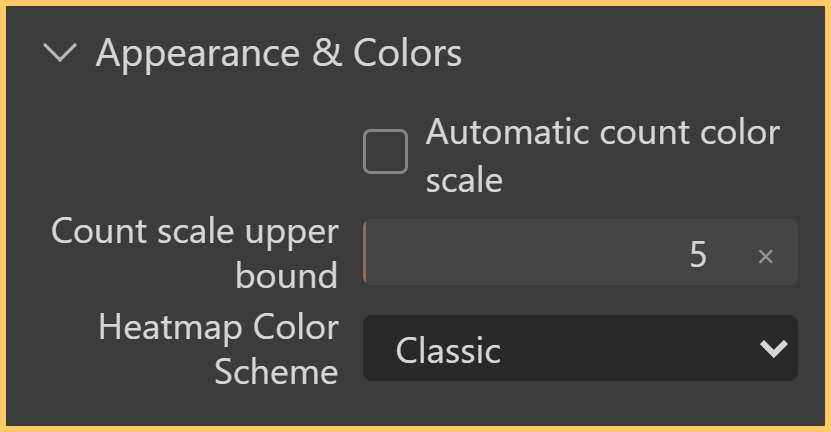
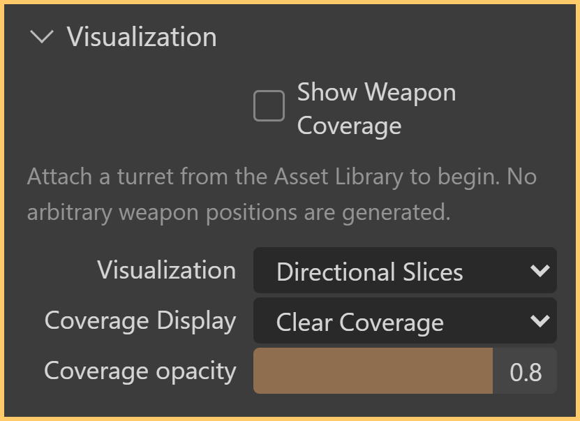
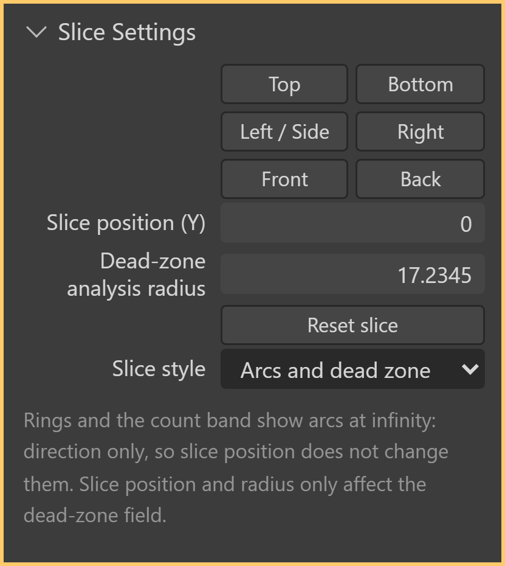
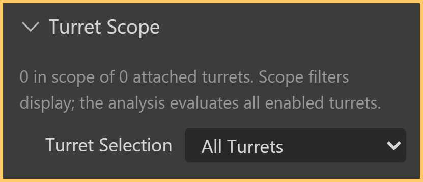
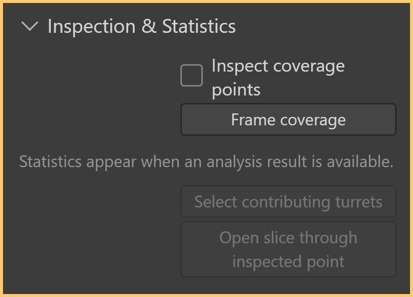
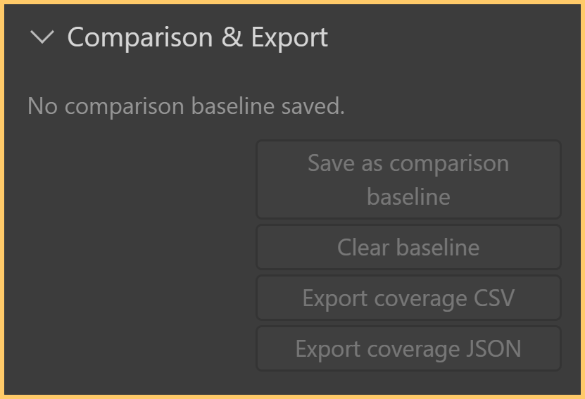
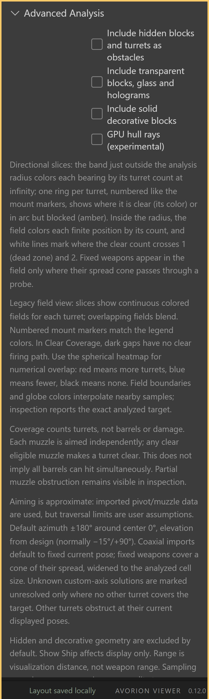

# Analyze weapon coverage

## Start an analysis

<!-- inline-capture:coverage-weapon-coverage-analysis-57 -->
:::{raw} html
<figure class="section-control-image"><figcaption>Weapon Coverage · Analysis</figcaption></figure>
:::
<!-- end-inline-capture -->

Coverage estimates where attached turrets can aim and whether geometry blocks their paths. Attach or restore turrets before starting.

1. Open **Properties > Weapon Coverage**.
2. Enable **Show Weapon Coverage**.
3. Choose **Directional Slices** or **Spherical Heatmap**.
4. Start with **Low · preview** sampling quality.
5. Wait for analysis to finish.
6. Increase quality to investigate a particular result.

Weapon Coverage is its own Properties tab in this release. Per-turret participation and fixed-aim settings are under **Turrets > Aiming Configuration**.

## Choose the display metric

<!-- inline-capture:coverage-weapon-coverage-appearance-colors-59 -->
:::{raw} html
<figure class="section-control-image"><figcaption>Weapon Coverage · Appearance &amp; Colors</figcaption></figure>
:::
<!-- end-inline-capture -->

<!-- inline-capture:coverage-weapon-coverage-visualization-55 -->
:::{raw} html
<figure class="section-control-image"><figcaption>Weapon Coverage · Visualization</figcaption></figure>
:::
<!-- end-inline-capture -->

| Coverage Display | What to examine |
|---|---|
| **Clear Coverage** | Directions or points with a clear eligible firing path |
| **Potential Coverage** | Coverage allowed by the aiming assumptions before obstruction classification |
| **Obstructed Coverage** | Eligible paths blocked by geometry |
| **Blind Spots** | Areas without clear coverage |
| **Change vs Baseline** | Direction-by-direction changes against a compatible spherical baseline |

Counts represent turrets, not barrels, shots, or damage. One eligible clear muzzle can make a turret count as clear. This does not mean all its barrels can hit at once.

## Read Directional Slices

<!-- inline-capture:coverage-weapon-coverage-slice-settings-58 -->
:::{raw} html
<figure class="section-control-image"><figcaption>Weapon Coverage · Slice Settings</figcaption></figure>
:::
<!-- end-inline-capture -->

Use the Top, Bottom, Left / Side, Right, Front, or Back buttons to choose a useful analysis view.

The default **Arcs and dead zone** display has two parts:

- Outer rings and the count band show distant aiming directions.
- The inner field shows finite nearby positions and dead zones.

One ring per turret uses numbering that corresponds to mount markers. Clear portions use the turret color; amber indicates an in-arc but blocked direction. White boundaries in the inner field identify transitions in clear coverage counts.

**Slice position** moves the nearby analysis plane along its named native axis. **Dead-zone analysis radius** changes the inner field's extent.

The outer arcs describe directions at infinity. Changing slice position does not move those arcs. It changes the nearby field.

**Legacy field view** provides the earlier continuous field presentation. Use the spherical display when you need a clearer numerical overlap view.

## Read Spherical Heatmap

The sphere samples positions around the ship at the selected radius. It helps you find weak directions and directions served by several turrets.

Use **Sphere radius** to choose the analysis distance. The classic palette uses hotter colors for more coverage and dark areas for none. **Blue / Orange** supplies an alternative color scheme.

**Automatic count color scale** adjusts the color range to the result. Turn it off and use a fixed upper bound when you want consistent count colors across comparisons.

**Sphere radius is an analysis distance, not weapon range.**

## Filter turrets and obstacles

<!-- inline-capture:coverage-weapon-coverage-turret-scope-56 -->
:::{raw} html
<figure class="section-control-image"><figcaption>Weapon Coverage · Turret Scope</figcaption></figure>
:::
<!-- end-inline-capture -->

**Turret Scope** offers All Turrets, Selected Turrets, or a Turret Group. Assign groups in the selected turret's Aiming Configuration.

The scope filters the displayed result. The underlying analysis evaluates all enabled turrets. Changing a display filter does not require a new analysis.

Analysis controls can show the ship, grid, structural obstructions, or only overlapping clear coverage. **Show Ship** changes display visibility; it does not remove the hull from obstruction analysis.

In **Advanced Analysis**, choose whether hidden, transparent, or decorative geometry participates as obstacles. Hidden and decorative geometry are excluded by default.

**GPU hull rays (experimental)** can accelerate the hull part on supported hardware. If unavailable, the app uses its CPU path. Grazing contacts can differ between the paths.

## Inspect a point

<!-- inline-capture:coverage-weapon-coverage-inspection-statistics-60 -->
:::{raw} html
<figure class="section-control-image"><figcaption>Weapon Coverage · Inspection &amp; Statistics</figcaption></figure>
:::
<!-- end-inline-capture -->

Enable **Inspect coverage points**, then inspect the displayed field. Read the exact analyzed sample, contributing turrets, and blocking geometry.

Use **Select contributing turrets** to identify those mounts. **Open slice through inspected point** creates a side slice through that point.

The visible color field interpolates samples. The inspected sample is more specific than a color boundary drawn between samples. Higher quality can help with narrow gaps, but sampling is still approximate.

## Compare a layout change

<!-- inline-capture:coverage-weapon-coverage-comparison-export-61 -->
:::{raw} html
<figure class="section-control-image"><figcaption>Weapon Coverage · Comparison &amp; Export</figcaption></figure>
:::
<!-- end-inline-capture -->

1. Finish an analysis of the original layout.
2. Open **Comparison & Export**.
3. Select **Save as comparison baseline** and give it a name.
4. Change the layout or aiming assumptions.
5. Wait for the revised analysis.
6. Read the statistics and choose **Change vs Baseline** if compatible.

Per-direction difference requires a spherical baseline with matching radius and quality. Otherwise, the app can compare summary statistics but falls back to Clear Coverage for the field.

Use **Export coverage CSV** or **Export coverage JSON** to keep sample targets, classifications, counts, and contributor information. Do not treat the in-app baseline as a downloaded backup.

## Understand analysis limits

<!-- inline-capture:coverage-weapon-coverage-advanced-analysis-62 -->
:::{raw} html
<figure class="section-control-image"><figcaption>Weapon Coverage · Advanced Analysis (visible portion)</figcaption></figure>
:::
<!-- end-inline-capture -->

Coverage uses imported pivot and muzzle information where available. Missing muzzle information can require estimates. Traversal, fixed-aim behavior, and spread include assumptions. Other turrets obstruct paths at their displayed poses.

Coverage does not calculate damage, simulate a battle, prove simultaneous barrel hits, or reproduce native game behavior exactly. Keep the assumptions consistent when comparing layouts.

Coverage overlays are viewport-only in this release. They are not included in the image or blueprint exports.
