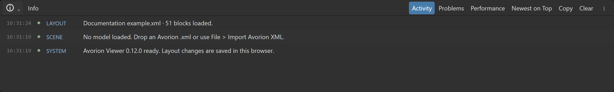

# Info

Info records activity and helps diagnose operations such as import, texture loading, painting and export. The current editor separates activity, problems and performance views.

## Header

Choose **Activity**, **Problems** or **Performance** where provided. Filters and entry order change the presentation of messages; they do not change the model.

## Activity and problems

Review warnings and errors after an unsuccessful operation. Use newest-on-top or newest-on-bottom order to follow the sequence. **Copy** collects the relevant log; review it before sharing.

## Clear

**Clear** removes activity entries, not the loaded ship. Copy useful diagnostics before clearing them.

## Performance

The performance view helps identify costly operations. Treat values as measurements of the current browser, model and device, not as a guarantee for another machine. Include the app version and operation when reporting a problem.
