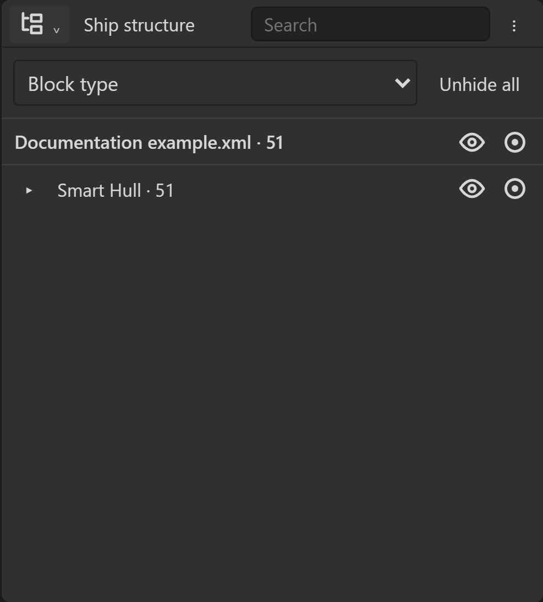

# Outliner

The Outliner shows the ship structure and attachments as a tree. It helps locate blocks that are difficult to pick in the viewport and organize inspection by type, material or other supported grouping.

## Header

Use the search and grouping controls to narrow the tree. Selection remains shared with the viewport. Changing a grouping changes how rows are presented, not the ship's imported block hierarchy.

## Block lines

Expand a group to reach its block rows. Read names, counts and visibility indicators in context. Large groups can show a limited initial set of children with a control to reveal more. A row's imported ID is more useful for identifying a block than its temporary screen position.

## Mouse actions

### Select

Select a row to inspect its block or attachment. Use the selection modifiers provided by the current interface; the viewport and Properties follow the relevant active context.

### Visibility

Use visibility controls or the context menu to hide, isolate and restore blocks. Hidden geometry can affect visible-scope paint targets and export framing.

### Context menu

Right-click for applicable inspection and visibility actions such as Focus, Isolate and Hide. These actions do not reshape imported blocks. See [Selection and inspection](../inspection/) for a detailed workflow.
