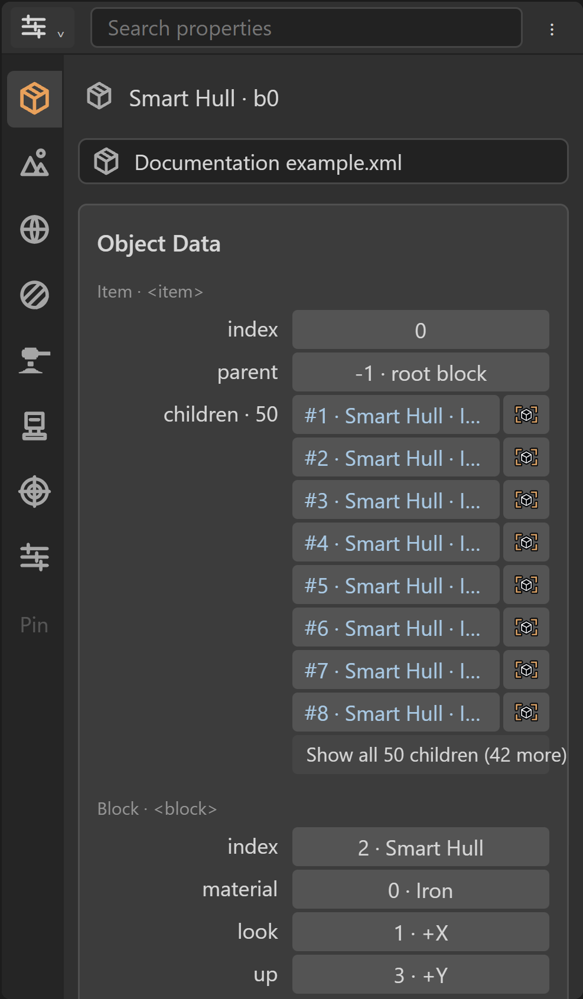
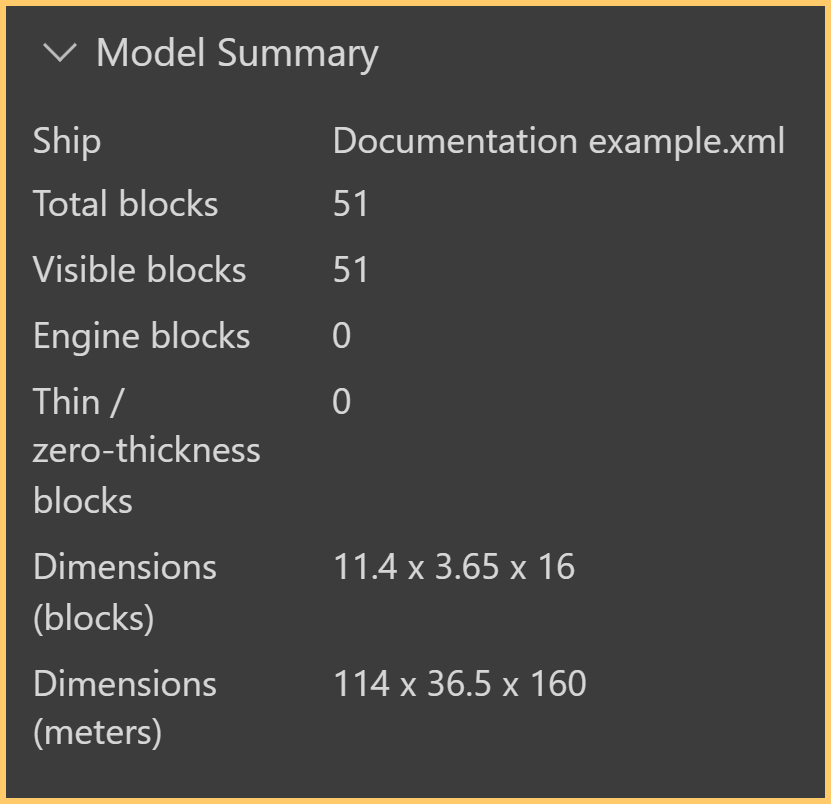
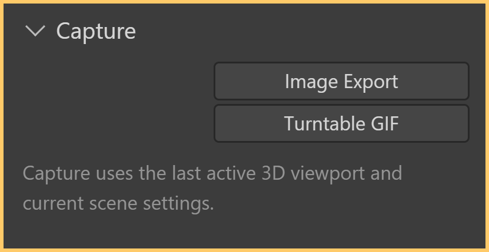

# Properties

Inspect the current selection and edit scene settings. The available controls depend on whether you are working with a ship or editing a library asset.

## Open this editor

Use the editor-type selector in any area header and choose **Properties**. Split an area first if you want to keep its current editor visible. See [Window system](../window-system/).

## Related editors and settings

- [Understand the screen](../user-interface/)
- [Set the background, lighting, and effects](../world/)
- [Analyze weapon coverage](../coverage/)

## Property tabs

| Tab | Purpose |
| --- | --- |
|  **Object properties** | Selected block data and appearance |
|  **Scene properties** | Scene summary and capture settings |
|  **World sky** | Background and generated sky |
|  **Shaders** | Material and rendering appearance |
|  **Turrets** | Mounts, pose and aiming |
|  **Components** | Component attachments |
|  **Weapon Coverage** | Coverage analysis and display |
|  **Workspace settings** | Layout and window-system information |

Library-asset editing replaces the normal ship properties with asset-specific controls.

### Model Summary

<!-- inline-capture:editor-properties-scene-properties-model-summary-42 -->
:::{raw} html
<figure class="section-control-image"><figcaption>Scene properties · Model Summary</figcaption></figure>
:::
<!-- end-inline-capture -->

Scene properties reports the model name, block counts and dimensions.

### Capture

<!-- inline-capture:editor-properties-scene-properties-capture-43 -->
:::{raw} html
<figure class="section-control-image"><figcaption>Scene properties · Capture</figcaption></figure>
:::
<!-- end-inline-capture -->

Scene properties provides capture actions for the last active viewport.
