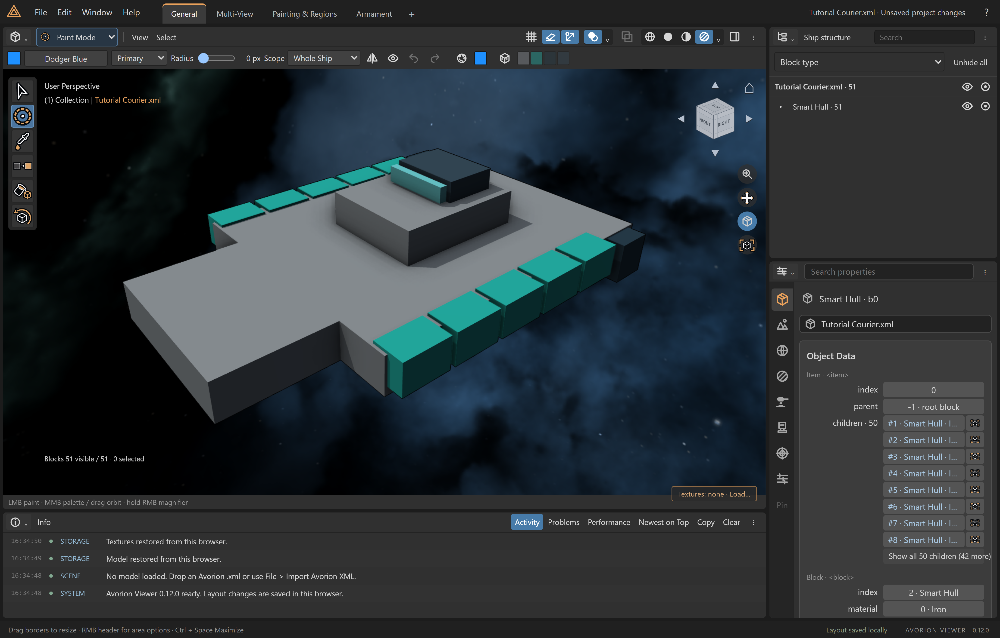
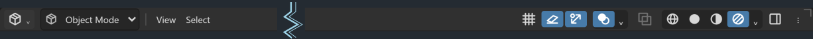

# 3D Viewport

The 3D Viewport displays the shared model. It provides navigation, selection, paint, attachment tools and display controls. Several viewports can show different views of the same ship.

## Header

<!-- inline-capture:viewport-header-area-options-25 -->
:::{raw} html
<figure class="section-control-image"><figcaption>Area options</figcaption></figure>
:::
<!-- end-inline-capture -->

<!-- inline-capture:viewport-header-editor-type-10 -->
:::{raw} html
<figure class="section-control-image"><figcaption>Editor type</figcaption></figure>
:::
<!-- end-inline-capture -->

The blueprint break line marks omitted empty spacing; the original bar is continuous.

### Mode

Object Mode is used for selection and inspection; Paint Mode enables viewport painting. **Tab** switches between them by default. Mode is different from the active tool and display shading.

### Menus

<!-- inline-capture:viewport-header-select-menu-12 -->
:::{raw} html
<figure class="section-control-image"><figcaption>Select menu</figcaption></figure>
:::
<!-- end-inline-capture -->

<!-- inline-capture:viewport-header-view-menu-11 -->
:::{raw} html
<figure class="section-control-image"><figcaption>View menu</figcaption></figure>
:::
<!-- end-inline-capture -->

The viewport's menus provide framing, standard views, projection, selection and region visibility. Their commands affect the current viewport or shared selection according to their purpose.

### Display controls

<!-- inline-capture:viewport-header-viewport-shading-23 -->
:::{raw} html
<figure class="section-control-image"><figcaption>Viewport Shading</figcaption></figure>
:::
<!-- end-inline-capture -->

<!-- inline-capture:viewport-header-rendered-shading-22 -->
:::{raw} html
<figure class="section-control-image"><figcaption>Rendered shading</figcaption></figure>
:::
<!-- end-inline-capture -->

<!-- inline-capture:viewport-header-material-preview-shading-21 -->
:::{raw} html
<figure class="section-control-image"><figcaption>Material Preview shading</figcaption></figure>
:::
<!-- end-inline-capture -->

<!-- inline-capture:viewport-header-solid-shading-20 -->
:::{raw} html
<figure class="section-control-image"><figcaption>Solid shading</figcaption></figure>
:::
<!-- end-inline-capture -->

<!-- inline-capture:viewport-header-wireframe-shading-19 -->
:::{raw} html
<figure class="section-control-image"><figcaption>Wireframe shading</figcaption></figure>
:::
<!-- end-inline-capture -->

<!-- inline-capture:viewport-header-toggle-x-ray-18 -->
:::{raw} html
<figure class="section-control-image"><figcaption>Toggle X-Ray</figcaption></figure>
:::
<!-- end-inline-capture -->

<!-- inline-capture:viewport-header-viewport-overlays-17 -->
:::{raw} html
<figure class="section-control-image"><figcaption>Viewport Overlays</figcaption></figure>
:::
<!-- end-inline-capture -->

<!-- inline-capture:viewport-header-show-overlays-16 -->
:::{raw} html
<figure class="section-control-image"><figcaption>Show Overlays</figcaption></figure>
:::
<!-- end-inline-capture -->

<!-- inline-capture:viewport-header-show-hide-0-thickness-blocks-14 -->
:::{raw} html
<figure class="section-control-image"><figcaption>Show/Hide 0 thickness blocks</figcaption></figure>
:::
<!-- end-inline-capture -->

<!-- inline-capture:viewport-header-toggle-grid-13 -->
:::{raw} html
<figure class="section-control-image"><figcaption>Toggle grid</figcaption></figure>
:::
<!-- end-inline-capture -->

Use shading and overlay controls to compare wire edges, solid form, material colors and rendered appearance. See [Viewport display](../display/) for the full reference.

## Tools

### Select and inspect

<!-- inline-capture:editor-viewport-select-sockets-2 -->
:::{raw} html
<figure class="section-control-image"><figcaption>Select Sockets</figcaption></figure>
:::
<!-- end-inline-capture -->

<!-- inline-capture:editor-viewport-select-1 -->
:::{raw} html
<figure class="section-control-image"><figcaption>Select</figcaption></figure>
:::
<!-- end-inline-capture -->

Click a block or drag a selection box. Select Sockets chooses attachment points rather than hull blocks. See [Selection and inspection](../inspection/) for visibility, Outliner interaction and selection rules.

### Navigate

<!-- inline-capture:editor-viewport-frame-all-5 -->
:::{raw} html
<figure class="section-control-image"><figcaption>Frame all</figcaption></figure>
:::
<!-- end-inline-capture -->

<!-- inline-capture:editor-viewport-pan-4 -->
:::{raw} html
<figure class="section-control-image"><figcaption>Pan</figcaption></figure>
:::
<!-- end-inline-capture -->

<!-- inline-capture:editor-viewport-orbit-3 -->
:::{raw} html
<figure class="section-control-image"><figcaption>Orbit</figcaption></figure>
:::
<!-- end-inline-capture -->

Orbit, pan, zoom and frame the ship using gestures, toolbar tools or menus. See [Navigation](../navigation/) for input-preset differences and projection.

### Paint

Use Brush, Eyedropper, Replace Color, Connected Fill and Restore. Check scope and color channel before a stroke. The [Painting](../painting/) chapter contains a complete before-and-after example.

## Gizmos

<!-- inline-capture:viewport-header-show-gizmos-15 -->
:::{raw} html
<figure class="section-control-image"><figcaption>Show Gizmos</figcaption></figure>
:::
<!-- end-inline-capture -->

The view cube and axis controls choose standard orientations. Camera navigation gizmos help orbit, pan, zoom and frame without memorizing gestures. Attachment transform gizmos appear in the appropriate editing context; they do not make imported hull geometry editable.

## Sidebar

<!-- inline-capture:viewport-header-toggle-sidebar-24 -->
:::{raw} html
<figure class="section-control-image"><figcaption>Toggle sidebar</figcaption></figure>
:::
<!-- end-inline-capture -->

Open the viewport sidebar with **N**. Native Transform reports block information, while View contains camera settings. The separate Properties editor can stay visible beside it.
