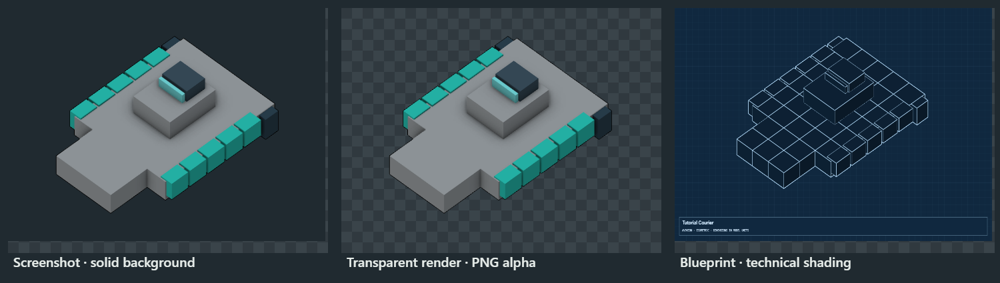

# Export

Export turns the working model or viewport into a game file, picture, animation or mesh. Choose the output for the next tool or audience, rather than treating every export as a project backup.

## Choose the output

| Need | Route |
| --- | --- |
| Resume editing later | Save a Model Project |
| Painted XML for the game | File > Export Avorion XML… |
| Screenshot, transparent render, blueprint or turntable | Advanced Export > Image Export |
| GLB, glTF, OBJ or print geometry | Advanced Export > 3D Model Export |

The subchapters explain settings, units, preparation and limitations for each output family. Keep source files and a project alongside exported assets.
