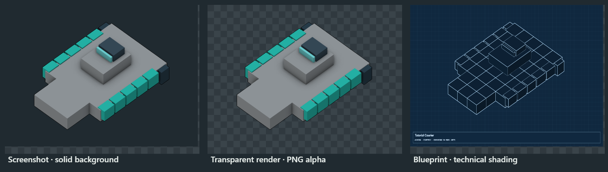
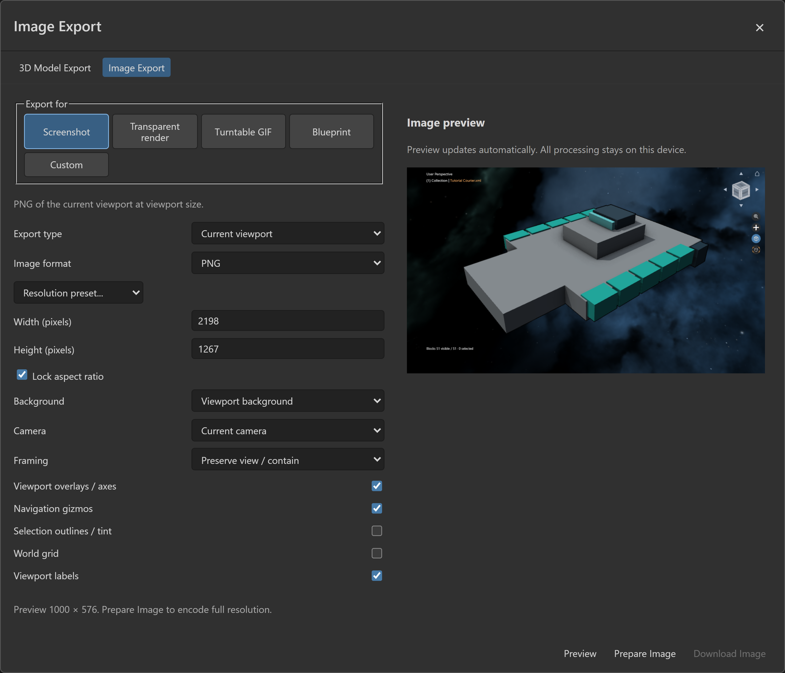

# Images & blueprints

Use the same [tutorial ship](../examples/tutorial-ship.xml) to compare these outputs. These are actual PNGs produced by Image Export, rather than mockups.

## Choose an image goal

Open **File > Advanced Export… > Image Export**. Scene Properties also offers **Image Export** and **Turntable GIF** shortcuts using the last active viewport.

| Goal | Starting result |
|---|---|
| **Screenshot** | Current viewport camera and appearance, without application panels |
| **Transparent render** | Framed ship image with a transparent background |
| **Blueprint** | Technical drawing with customizable views and notes |
| **Turntable GIF** | Complete rotating presentation |

A goal fills suitable settings. Changing those settings can switch the goal indicator to **Custom**.

## Prepare and download a still

**Example:** for a transparent image, choose **Transparent render**, keep **PNG**, prepare the image, then download it. The checkerboard is a preview aid; the downloaded file contains alpha.

1. Set ship visibility, camera, shading, and lighting in the viewport.
2. Open Image Export and choose a goal.
3. Choose PNG, WebP, or JPEG.
4. Set dimensions or choose a size preset.
5. Choose the background and framing.
6. Inspect the preview.
7. Select **Prepare Image**.
8. Wait for full-resolution preparation.
9. Select **Download**.

The preview is smaller than the final image. Changing export settings invalidates the prepared output. Download uses the prepared snapshot; later edits do not silently change it.

Screenshot captures viewport content, not app menus, panels, or temporary mouse gestures. Check overlays and selection options if you want a clean result.

### Choose transparency and format

- **PNG** supports transparency and does not have the JPEG/WebP quality setting.
- **WebP** supports transparency and adjustable encoding quality.
- **JPEG** needs an opaque background.

The checkerboard belongs to the transparent-image preview. It is not painted into the exported background.

Unsupported encoders report an error. If a format fails, choose another supported format rather than renaming a file extension.

### Set framing, projection, and overlays

| Option | Use |
|---|---|
| **Current camera** | Retain the chosen viewing angle |
| Standard camera preset | Choose front, back, side, top, bottom, or isometric |
| **Preserve view / contain** | Adapt the output shape while keeping the source view scale |
| **Preserve view / crop** | Fill the output shape, with possible cropping |
| **Fit visible ship** | Reframe visible geometry for the export |
| Framing margin | Add space around the ship when fitting |
| Perspective / orthographic | Choose a presentation or technical projection |

Overlay, gizmo, selection, grid, label, and dimension options are separate. A world grid and a blueprint page grid are also different.

High supersampling can improve edges. **2× per axis** uses four times the working pixels; **4× per axis** uses sixteen times. The final width and height remain the values you requested.

## Customize a blueprint

1. Choose **Blueprint**.
2. Open **Customize blueprint…**.
3. Choose **Single view** or **Multi-view (4 views)**.
4. Set the page grid, title block, and ship name.
5. For four views, adjust column and row proportions if needed.
6. Select each view and set its name, orientation, rotation, and scale.
7. Add dimensions and annotations.
8. Apply the customization.
9. Prepare and download the final image in Image Export.

Each view has its own settings. Click the view you want before adjusting it. Use its navigation cube, **Orbit**, **Pan**, and **Frame All** to compose it. **Move sheet** moves your editor view of the sheet rather than redefining the ship geometry.

**Sheet zoom**, the scroll wheel, and **Fit sheet** change how the page fits in the customization window. They do not change the requested export resolution. **Full screen** gives you more editing space; **Exit full screen** restores the dialog.

**Model scale (%)** changes the ship's presentation within the selected view. It is different from Sheet zoom and from the physical size setting in 3D export.

Dimension controls can add labels, a cage, and a font-size setting per view. Review the actual labels and units before publishing a dimensional claim.

The blueprint renderer uses technical shading and crease edges. Glass becomes an opaque technical surface. It does not copy every effect from Rendered shading.

### Add blueprint annotations

In a view's **Annotations** controls:

1. Enter the note text.
2. Select **Add annotation**.
3. Drag the text to its desired position.
4. Drag the circular leader handle to the reference point.
5. Adjust font size, color, leader line, and arrow.

Select an existing note from the list to edit or delete it. **View Annotations** shows or hides that view's notes. Each view can contain up to 50 annotations.

Use short notes with clear reference points. Check the prepared full-size image for clipped text and notes that cross another view.

## Make a ship Turntable GIF

1. Choose **Turntable GIF**.
2. Set duration and frames per second.
3. Choose clockwise or counterclockwise rotation.
4. Choose camera angle and elevation.
5. Use **Frame All (complete rotation)** when you want the entire ship to remain inside the image.
6. Check the preview, then prepare and download the GIF.

This export has a duration of 1–20 seconds and a frame rate of 5–30. It limits each side to 2048 pixels and total frame-pixels to 160 million. The dialog can reduce oversized dimensions to fit duration and frame-rate limits. Read the displayed dimensions after changing a preset.

GIF uses limited colors and binary transparency. The preview uses reduced size and frame rate. Use a still with PNG/WebP when you need smoother transparency.

Ship Turntable GIF and Turret Studio animation export have different controls and limits.

## Image export limits

Still-image dimensions accept whole pixels up to 32,768 per side, subject to memory and browser encoder limits. A permitted field value does not guarantee that your device can create that image.

If preparation fails, reduce dimensions, supersampling, or costly effects. A larger memory budget is an estimate, not additional physical memory.

Some rendering stages cannot stop immediately. Wait for cancellation to finish before starting another large export.

Weapon Coverage overlays are excluded from image and blueprint outputs. App panels are also excluded. Use your browser or operating system's screen capture if you need an image of the interface itself.
