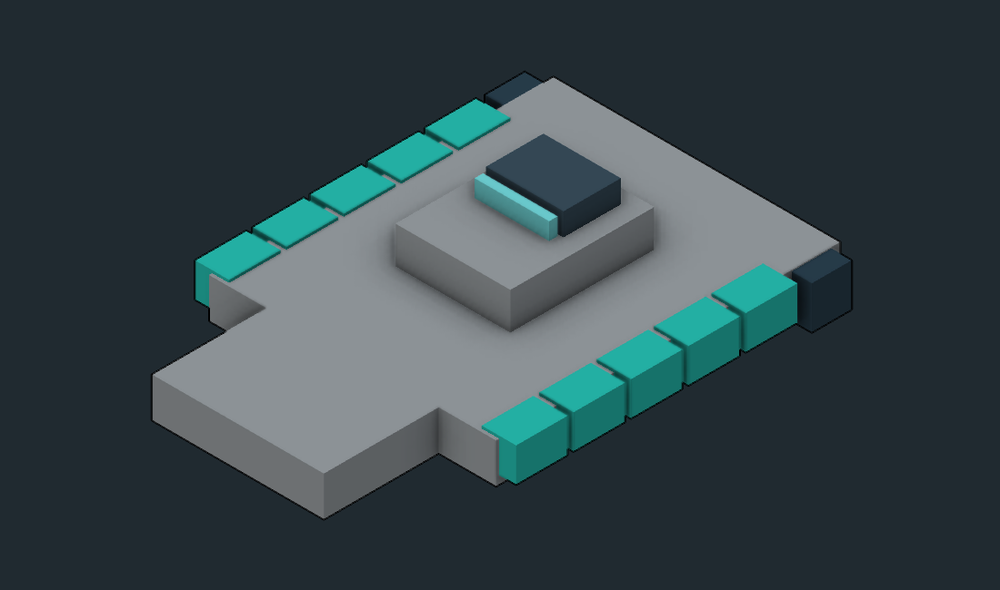

# Open a ship and load textures

Try the guide with the [downloadable Tutorial Courier XML](../examples/tutorial-ship.xml). It is a small, texture-free example created for this documentation. Open it, paint the side panels, and export a picture without needing a game texture folder.

## Before you start

Use a browser with WebGL2 support. A desktop or laptop with a pointer and keyboard gives the intended experience. Available memory and graphics capacity limit large models and exports.

Have these files available:

- An Avorion ship or station plan in an `.xml` file.
- Your game texture folder, if you want textured surfaces.
- Separate turret or component XML designs, if you want to use those tools.

Textures are optional. Without them, the viewer uses plain colors and fallback surfaces.

## Open your first ship

1. Go to **[avorion-viewer.com](https://avorion-viewer.com)**.
2. Choose **Blender** or **Laptop** controls on the welcome screen.
3. Select **Open Avorion XML…**.
4. Choose the XML file.
5. Wait for the model to appear.
6. Press **Home** if the model is outside the view.

You can also drop a ship XML file onto the viewport. Use **File > Import Avorion XML…** to replace the current model.

An import error leaves the current model unchanged. Read the error, then use **Choose another file…** if necessary.

Reopen the welcome screen through **Help > Welcome**. Its **Read guide** button opens the bundled Quick Start Guide.

## Choose controls

| Preset | Suitable hardware | Main gesture |
|---|---|---|
| **Blender** | Mouse with a middle button; numeric keypad is useful | Middle-button drag rotates the view |
| **Laptop** | Mouse without a middle button, or keyboard without a numeric keypad | **Alt+left-drag** rotates the view |

Change the preset through **Help > Input style…** or **Preferences > Input**.

**Trackpad is unavailable in this checkout.** Choose Blender or Laptop controls.

## Load textures

1. Select **Load texture folder…** on the welcome screen, or **File > Load local texture folder…**.
2. Choose the folder containing your Avorion texture images.
3. Wait for loading to finish.
4. Choose **Material Preview** or **Rendered** shading.
5. Check the texture count shown by the viewer.

You can also drop texture images or a texture folder onto the app. Missing texture maps use fallback surfaces.

Loaded textures are kept in this browser when storage is available. They can be restored on your next visit. To remove them, use **File > Unload textures**. This removes the saved texture imports; it does not delete your game files.

## Set import placement

Open **Preferences > Save & Load > Model Import > Placement** before the next import.

| Choice | Display result |
|---|---|
| **Default · Centered on world axes** | Centers the ship on all workspace axes |
| **Placed · Rest on floor** | Centers the ship across the floor and puts its lowest point on the floor |
| **As Imported** | Uses the imported position |

This setting affects the next model import. It does not rewrite the coordinates in a preserved XML download.
