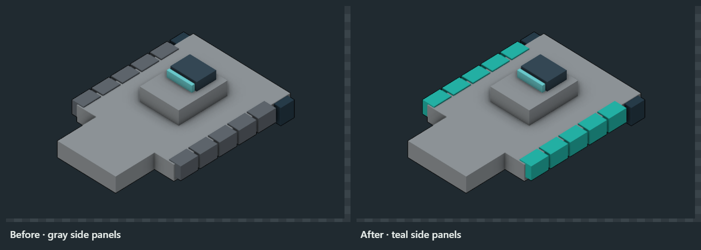
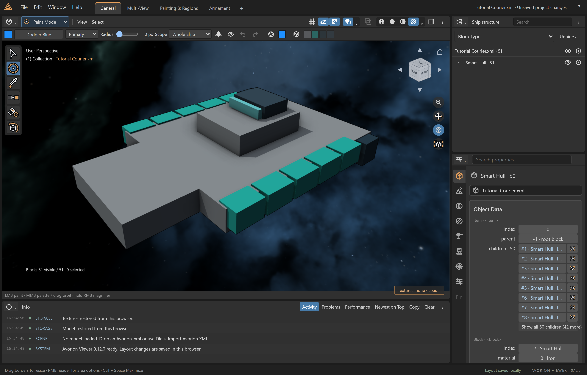
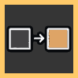

# Painting

Recolor whole blocks with a controlled scope. Start with the tutorial below, then use the tool and precision references when you need them.

## Try it: repaint the side panels

Use the [tutorial ship](../examples/tutorial-ship.xml). Keep the main hull gray and change only the side panels to teal. The pair below shows the same ship and camera before and after a scoped paint change.

### Make a controlled first change

<!-- inline-capture:painting-hide-turrets-and-components-34 -->
:::{raw} html
<figure class="section-control-image"><figcaption>Hide Turrets and Components</figcaption></figure>
:::
<!-- end-inline-capture -->

1. Open the tutorial XML. In Object Mode, select a few of the narrow gray side panels.
2. Choose **Paint Mode** in the viewport header, or press **Tab**.
3. Choose the **Brush** tool.
4. Set scope to **Selected Blocks**.
5. Choose the **Primary** channel.
6. Choose a teal brush color.
7. Set **Radius** to **0**.
8. Click the selected side panels. The central hull should stay gray.
9. Use **Undo** to check that you can reverse the result.

The paint toolbar below the viewport header contains color, channel, radius, scope, palettes, symmetry, magnifier, and history controls. In a narrow viewport, scroll the settings row horizontally.

The toolbar also has a control to hide turrets and components while you work on the hull. Check attachment visibility again before a presentation export.

### Understand whole-block painting

The brush changes a block's color value. It does not draw a colored patch on one face.

**Radius 0** targets the block under the cursor center. A larger radius samples visible surfaces inside a circular area. Very small blocks between samples can be missed. Move slowly or use Radius 0 for small details.

The blue circle shows brush radius. Hover tint previews eligible surfaces. An orange indication can identify a scope restriction. Hover information can show the current color, proposed color, and target count.

One completed brush stroke is one paint history operation. Press **Escape** before finishing a stroke to cancel it.

## Choose a tool

**Find the controls:** choose Paint Mode in the viewport header, select a tool on the left, then check color, channel, radius and scope in the painting toolbar before starting a stroke.

| Tool | What it does | Important detail |
|---|---|---|
|  **Select** | Selects blocks by click or box | Build a selection without leaving Paint Mode |
|  **Brush** | Paints blocks hit within the brush area | Radius controls the sampled screen area |
|  **Eyedropper** | Samples the current color channel | Sampling does not paint |
|  **Replace Color** | Replaces every matching color in scope | Matching includes the alpha value |
|  **Connected Fill** | Fills connected matching blocks from a clicked seed | Choose a **Fill match** rule |
|  **Restore** | Restores imported color values within its brush area | Restoration can be undone |

Connected Fill can match color, material, or block type. A nonmatching or excluded block interrupts a matching path. Face contact or overlapping bounds can connect blocks; an edge or corner contact alone does not.

Connected Fill uses rectangular block bounds. Slopes or hollow blocks can therefore connect where their visible surfaces do not touch exactly. Check the result and undo if needed.

Replace Color and Connected Fill can affect more than the clicked surface. Start with a restricted scope when you are learning them.

## Set paint scope

| Scope | Eligible targets |
|---|---|
| **Whole Ship** | Live blocks permitted by the current visibility filters |
| **Selected Blocks** | Eligible visible blocks that are selected |
| **Active Region** | Eligible visible blocks in the toolbar's chosen region |

Whole Ship gives a tool access across the visible ship. It does not make a brush stroke repaint everything.

An empty selection or missing active region locks painting. The app does not silently switch to Whole Ship. Manually hidden and filtered thin blocks are excluded from these viewport paint tools.

Eyedropper can read a visible target without changing it.

The Color Editor's **Apply to Selected** and **Apply to Region** are separate bulk actions. Check their named target; do not assume the viewport brush scope limits those actions.

## Choose a color channel

<!-- inline-capture:painting-brush-color-32 -->
:::{raw} html
<figure class="section-control-image"><figcaption>Brush color</figcaption></figure>
:::
<!-- end-inline-capture -->

**Primary** changes the main paint channel. **Secondary** changes the secondary paint channel used by supported surface details.

Imported color values use **AARRGGBB**: alpha, red, green, and blue. Alpha controls strength or transparency according to the material and channel.

Primary painting retains the block's alpha. Secondary painting can preserve its alpha or set full strength (**FF**). A secondary color with zero alpha can remain invisible after an RGB change. Choose full strength when that is your intended result.

Restore returns the selected channel to its imported state. If the imported block had no secondary attribute, Restore can remove the added secondary override.

## Colors & palettes

### Sample colors accurately

Eyedropper selects exact matches from the named Avorion palette. It does not convert an unknown imported color to the nearest named color.

If the imported RGB has no palette match, or the secondary channel is absent, the brush can remain unchanged. Read the sample message. Sampling reports alpha but does not copy it into the brush.

### Use palettes while painting

<!-- inline-capture:painting-model-palette-39 -->
:::{raw} html
<figure class="section-control-image"><figcaption>Model Palette</figcaption></figure>
:::
<!-- end-inline-capture -->

<!-- inline-capture:painting-palette-dodger-blue-38 -->
:::{raw} html
<figure class="section-control-image"><figcaption>Palette Dodger Blue</figcaption></figure>
:::
<!-- end-inline-capture -->

<!-- inline-capture:painting-paint-palettes-37 -->
:::{raw} html
<figure class="section-control-image"><figcaption>Paint palettes</figcaption></figure>
:::
<!-- end-inline-capture -->

Select a saved active palette in the paint palette controls. The toolbar can also show recent colors and the current harmony colors.

Click and release the middle mouse button without dragging to open the radial palette. Dragging with the middle button still orbits.

- Select a swatch to change the brush color.
- Use the menu's pages for palettes with more than eight colors.
- Use arrow keys and **Enter** to choose a swatch.
- Press **Escape** to dismiss the menu.

Choosing a swatch does not paint until you make a stroke or use an Apply action.

**Model Palette** lists colors already used by the ship, ordered by block count. Imported colors without named matches remain visible with their values. Its visibility controls help you hide or isolate color groups.

## Precision tools

### Paint with symmetry

<!-- inline-capture:painting-paint-symmetry-33 -->
:::{raw} html
<figure class="section-control-image"><figcaption>Paint symmetry</figcaption></figure>
:::
<!-- end-inline-capture -->

Open **Paint symmetry**. Enable Mirror X, Y, or Z, and choose the plane coordinate for each axis. **Use Ship Center** puts the planes at the model bounds center.

Symmetry uses native ship axes: X right, Y up, Z back. These differ from the workspace's displayed Z-up axes.

Mirroring looks for existing blocks with matching reflected centers, dimensions, and type. It does not create missing blocks. Both the original and mirrored target must be in scope.

The eye control hides a symmetry guide without disabling mirroring. Check the enabled axis controls before painting. The viewport's master overlays switch can also hide the guides.

### Use the magnifier

1. Put the pointer over the detail.
2. Hold the right mouse button.
3. Move into the offset magnifier.
4. Click or drag with the left button to paint.
5. Release the left button to end the stroke.
6. Release the right button to close the magnifier.

The magnifier stays anchored to the original surface location. Use Radius 0 for small targets.

Configure zoom, size, quality, and optional wireframe through the magnifier controls or Preferences. **Smooth pixels** enlarges the existing image. **Render detail** redraws the area for more detail and uses more graphics capacity.

Brush radius remains measured in the main viewport's pixels. It therefore appears larger inside the magnifier.

## Undo, redo, and save paint

<!-- inline-capture:painting-redo-36 -->
:::{raw} html
<figure class="section-control-image"><figcaption>Redo</figcaption></figure>
:::
<!-- end-inline-capture -->

<!-- inline-capture:painting-undo-35 -->
:::{raw} html
<figure class="section-control-image"><figcaption>Undo</figcaption></figure>
:::
<!-- end-inline-capture -->

Use the paint toolbar, **Edit > Undo Paint / Redo Paint**, or the paint shortcuts. Paint history is limited to 30 transactions and a bounded number of changed records. Importing a different model resets paint history.

Undo shortcuts are context-sensitive when attachment tools are active. Return to the paint viewport or Color Editor if you want to undo paint specifically.

Download the result through **File > Save preserved XML…**. This writes a copy with color changes while retaining the imported XML structure and native placement. Browser restoration alone is not a backup.
