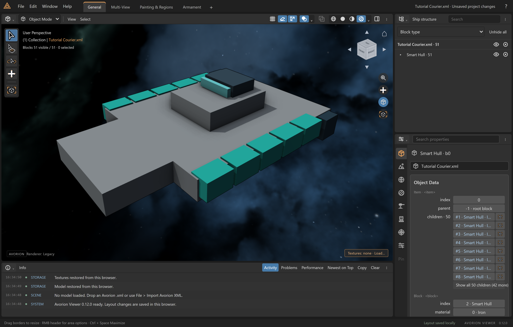

# Understand the screen

Use the screenshot as a map: the viewport occupies the left, Outliner and Properties share the right, and Info shows activity below the viewport. These are editor areas; their arrangement can change.

## Main areas

| Area | Purpose |
|---|---|
| Top menu | Open files, save, export, change preferences, and get help |
| Workspace tabs | Switch between saved screen arrangements |
| **3D Viewport** | View the ship and use selection, painting, and socket tools |
| **Outliner** | Browse the ship structure and mounted attachments |
| **Properties** | Examine data and change settings |
| **Asset Library** | Browse turret or component designs |
| **Color Editor** | Choose colors, save palettes, and manage regions |
| **Info** | Read activity messages, errors, and warnings |
| **Preferences** | Change app controls, appearance, and storage behavior |
| Status bar | Read contextual hints, save status, and version information |

Each rectangular editor has a header. Its editor-type menu lets you change what that area contains. For example, you can change an Info area into an Asset Library.

## Mode, tool, shading, and workspace

These controls have different jobs:

| Control | What it changes |
|---|---|
| **Object Mode / Paint Mode** | Your main interaction with the ship |
| Tool shelf | The action of a click or drag, such as selection, painting, or socket selection |
| Shading buttons | The appearance of the model |
| Workspace tab | The arrangement and settings of editor areas |

**Select Sockets** is a tool used for attachments. It is not a third mode in the current mode menu. **Tab** switches between Object Mode and Paint Mode.

## Find a property

Use the search field in the Properties header. Search includes labels, panel names, and displayed values across Properties tabs.

- Press **Enter** to move to the next result.
- Press **Shift+Enter** to move to the previous result.
- Press **Escape** in the search field to clear it.
- Select **Open tab** in a result group to leave search and open that tab.

The ship Properties tabs include Object, Scene, World, Shaders, Turrets, Components, Weapon Coverage, and Workspace. A turret asset workspace has a different set of tabs.

## Pin an attachment inspector

Select an attachment or socket, then use **Pin** in Properties to keep that attachment context while you select something else.

Use **Unpin** to follow the current selection again. If the pinned attachment is no longer available, unpin the inspector. Separate Properties areas can help you keep a reference beside the active inspector.

## Change a numeric value

Many Properties fields support direct entry and dragging:

- Drag to adjust the value.
- Hold **Shift** for fine adjustment.
- Use **Ctrl** for stepped adjustment where supported.
- Double-click the value, or press **Enter**, to type it.
- Press **Enter** to accept typed input.
- Press **Escape** to cancel the active edit.
- Use **Alt+Backspace** to restore the field's default where supported.

Some fields show mixed values when several selected items differ. Read the field's unit and limits before applying a value to several items.

## Read the scene summary and viewport sidebar

Open **Properties > Scene properties > Model Summary** to read the ship name, total and visible block counts, engine count, thin-block count, and dimensions. Capture actions in this tab use the last active viewport.

Press **N** in a viewport to open its sidebar. **Native Transform** shows the active block's position, dimensions, and orientation information. These values are read-only. Engine State and Thruster Preview controls provide display previews, and **View** contains camera settings.

Drag the sidebar's inner border to change its width. The sidebar belongs to that viewport; the separate Properties editor remains available beside it.

## Editors at a glance

Choose an editor from the selector at the left of an area header. Each editor can occupy an area in any workspace.

### 3D Viewport

View the shared ship, navigate, select blocks, paint, and select mounting sockets. Each viewport has its own camera and display settings.

### Outliner

Browse Ship Structure and attachments. Use selection, visibility and isolation to examine internal construction. Selection is shared with the viewport.

### Properties

Inspect the current selection and edit scene settings. The available controls depend on whether you are working with a ship or editing a library asset.

### Info

Read activity messages, errors and warnings. Use this editor when an import, texture load, or export does not behave as expected.

Filter **Errors & Warnings**, reverse the entry order, or use **Copy** to collect the activity log. **Clear** removes log messages, not the ship.

### Preferences

Configure input, appearance, storage and application behavior. Open Edit > Preferences, or choose Preferences in an area’s editor selector.

### Color Editor

Choose verified game colors, compare harmonies, save palettes, and work with named regions. Window > Open Color Workshop opens a workspace containing this editor.

### Asset Library

Browse reusable turret and component designs. Folder-based model browsing and texture import also have dedicated file commands.
