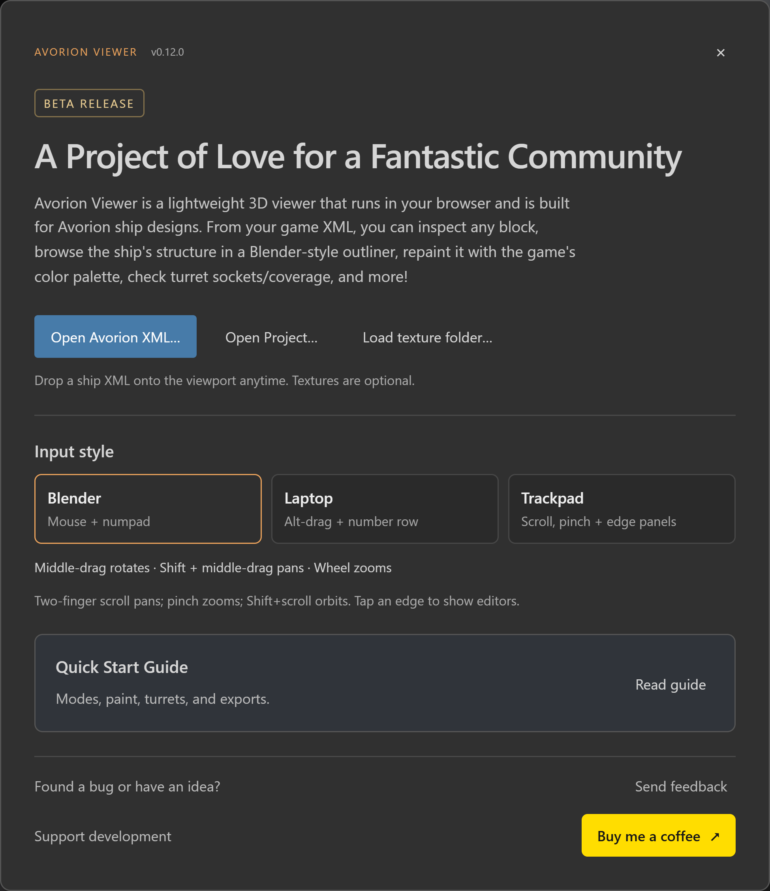

# Splash Screen

The app calls its opening screen **Welcome**. Reopen it with **Help > Welcome**. It provides the initial file actions and input-style choices.

## Open a model or project

Choose **Open Avorion XML…** for a game plan, or **Open Project…** to resume a Model Project. **Load texture folder…** adds optional game surfaces. You can also drop XML onto the viewport after closing Welcome.

## Input style

Choose a supported input preset for your hardware. Blender uses a middle mouse button and keypad; Laptop provides alternatives. Read the availability shown by the running release before choosing Trackpad, because support has varied between builds.

## Guide and feedback

**Read guide** opens the short first-use guide. Full editor references are available from **Help > Documentation**. Close Welcome to return to the current model; opening the screen alone does not replace it.
