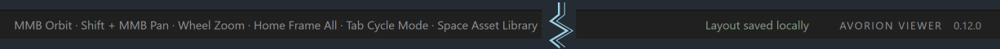

# Status Bar

The status bar sits below the editor layout. It provides short contextual hints and application/session information.

The blueprint break line marks omitted empty spacing; the original bar is continuous.

## Contextual hints

Move the pointer over an editor or control to read relevant gestures and commands. Hints can change with the current tool. Read a disabled command's explanation when an action is unavailable.

## Activity and save state

Short messages can confirm an action or report a failure. Use the [Info editor](../editor-info/) for persistent activity details, warnings and errors. A message about browser persistence is not proof that a portable project file has been downloaded.

## Version

The displayed application version helps identify the build when reporting a problem. Include it with the affected file type and operation; do not include private model data unless you intend to share it.
