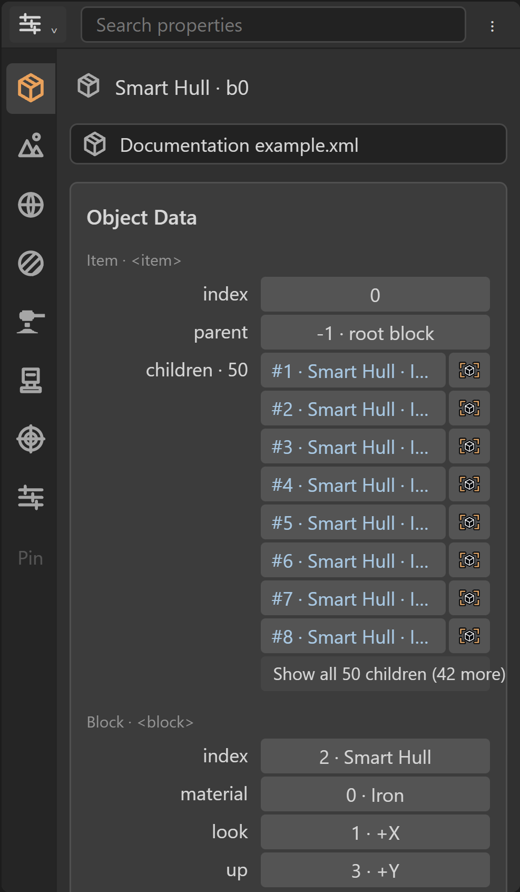

# Tabs & Panels

Tabs choose a group of related controls. Panels divide that group into smaller sections that can be collapsed.

## Tabs

Use a tab to switch context, such as World, Shaders or Turrets in Properties, or Wheel, List, Palettes and Regions in the Color Editor. Keyboard-enabled vertical tab lists support arrow keys and Home/End.

## Panels

Select a panel heading to open or close it. In editors using the shared panel controls, **Ctrl+click** on a panel heading focuses that panel and collapses unrelated panels. Saved open states can make your screen differ from a documentation capture.

## Search and scrolling

Search can expose matches across collapsed panels or tabs. Read the result's context before editing. Narrow editors may scroll horizontally or vertically; a hidden control may be outside the current scroll area rather than unavailable.

## Numeric fields

Many numeric controls support dragging, **Shift** for fine adjustment, or direct typing. Press **Enter** to accept and **Escape** to cancel. Read the displayed units and limits before applying a value to several selected items.
