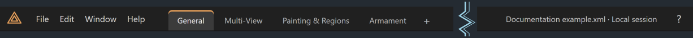
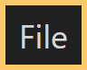
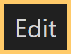
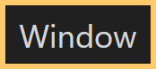
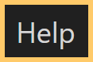

# Topbar

The topbar contains application menus and workspace tabs. It acts on the application rather than only the editor under the pointer.

The blueprint break line marks omitted empty spacing; the original bar is continuous.

## Application menus

| Menu | Main purpose |
| --- | --- |
|  **File** | Import, save projects, manage folders, export and clear the scene |
|  **Edit** | Paint undo/redo and Preferences |
|  **Window** | Color Workshop, maximize/focus and workspace management |
|  **Help** | Welcome, shortcuts, input style, Documentation, feedback and application information |

A disabled command can explain its prerequisite. For example, source-preserving XML export needs an imported XML model.

## Workspace tabs

Select a tab to change the arrangement of editors. Double-click a tab to rename it; its context menu provides further workspace actions. See [Workspaces](../workspaces/).

## Editor headers are separate

The topbar's menus are not the same as an editor's header menus. A viewport's View menu changes that viewport; a File command can replace the loaded model for every viewport.
