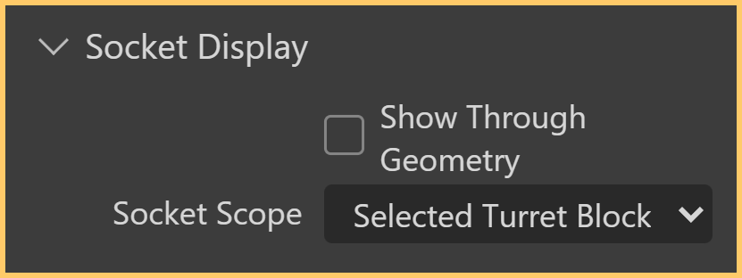
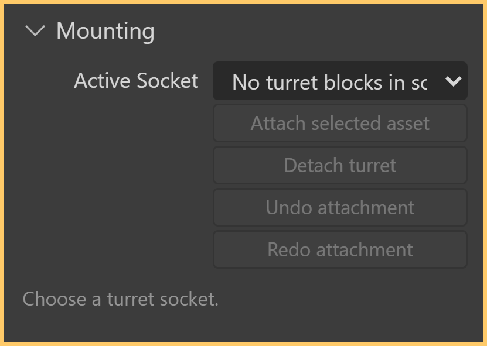
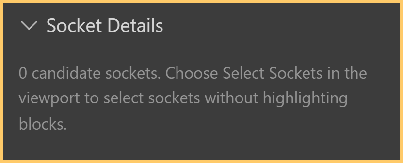
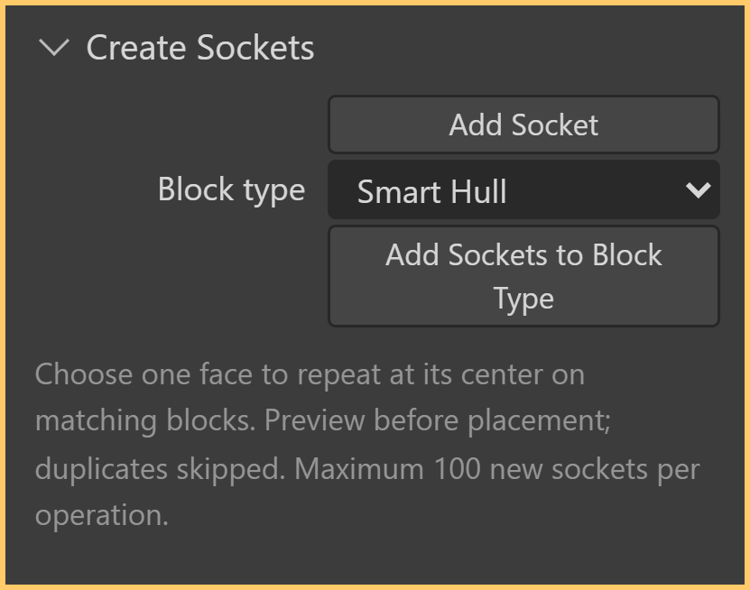
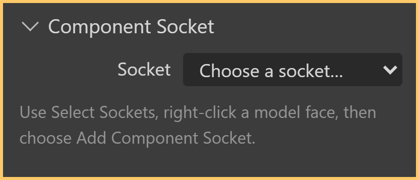
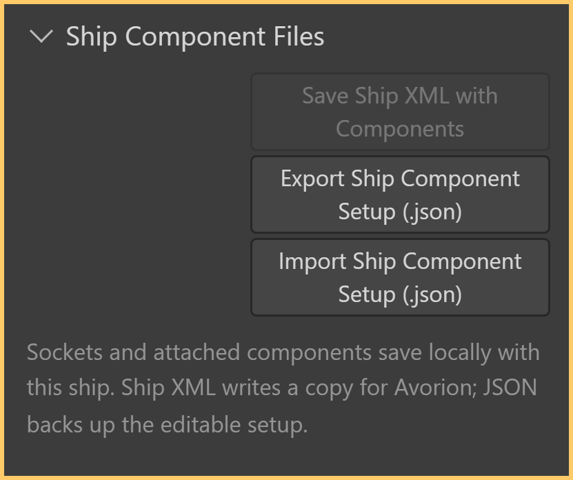

# Place and adjust turrets

## Select turret sockets

<!-- inline-capture:turrets-turrets-socket-display-47 -->
:::{raw} html
<figure class="section-control-image"><figcaption>Turrets · Socket Display</figcaption></figure>
:::
<!-- end-inline-capture -->

Use the **Armament** workspace or add an Asset Library beside a viewport.

1. Load a ship with compatible turret mounting blocks.
2. Import a turret XML into **Asset Library > Turrets**.
3. Activate the viewport's **Select Sockets** tool.
4. Open **Properties > Turrets > Socket Display**.
5. Set **Socket Scope** to **All Turret Blocks**, or select the mounting blocks you want.

**Show Through Geometry** helps you see socket markers behind surfaces. Seeing a marker does not guarantee that attachment is permitted. An obscured or unavailable socket can remain blocked for placement.

## Attach a turret

<!-- inline-capture:turrets-turrets-mounting-48 -->
:::{raw} html
<figure class="section-control-image"><figcaption>Turrets · Mounting</figcaption></figure>
:::
<!-- end-inline-capture -->

For direct placement:

1. Select the turret asset.
2. Choose an empty **Active Socket** in Turrets > Mounting, or select it in the viewport.
3. Select **Attach selected asset**.
4. Examine the mounted result.

You can also drag an asset toward a socket. Where the placement strip is shown, check the target, size, and mount rotation before choosing **Place**. An occupied target uses **Replace** instead.

Attachment can be unavailable when no socket is selected, the socket is occupied or obscured, or the asset lacks authored size metadata. Read the explanation in Mounting.

## Change pose and size

<!-- inline-capture:turrets-turrets-socket-details-49 -->
:::{raw} html
<figure class="section-control-image"><figcaption>Turrets · Socket Details</figcaption></figure>
:::
<!-- end-inline-capture -->

Select the mounted turret, then open **Transform & Pose**.

| Control | Result |
|---|---|
| **Body rotation** | Rotates the turret body around its yaw axis |
| **Barrel elevation** | Raises or lowers the barrel within the asset's limits |
| **Turret size** | Changes size in half-unit steps, within socket limits |
| **Lower / Neutral / Upper** | Sets a useful test pose |
| **Reset pose** | Restores the mounting twist, body rotation, and elevation defaults |
| **Copy pose and size / Paste pose and size** | Reuses those settings on another selected turret |

The viewport's context tools also provide rotation, resizing, replacement, and detachment. Mount rotation and body rotation are different: mount rotation turns the whole attached turret around the socket; body rotation turns its moving body.

Socket size limits can restrict a pasted or replacement size. Examine the actual mounted size after the operation.

## Replace or detach

Use the context toolbar's **Replace** action to choose another library turret. **Keep pose and size** retains compatible instance settings. Inspect the result before accepting it as your final layout.

Use **Detach turret** in Properties, or the context toolbar's detach action, to remove the mounted copy. This does not remove the reusable library asset.

**Undo attachment** and **Redo attachment** reverse supported turret attachment changes. Attachment history is separate from paint history.

## Manage turrets in the Outliner

Mounted turrets appear in the Outliner. Select them there to avoid picking through hull geometry. You can rename, hide, show, or detach them.

Use additive selection for several turrets. Pose fields can show mixed values for differing selections.

## Review embedded turret restoration

Some ship XML files contain embedded turret designs and mount references. The viewer attempts to restore them and reports the result.

If it shows **Review unresolved turrets**:

1. Open the review in Turrets Properties.
2. Read each reason.
3. Use **Select mounting block** to inspect the original location where available.
4. Choose a compatible repair socket.
5. Inspect the placement preview.
6. Select **Attach saved design** only when the result is correct.

Some face and orientation choices are inferred. Restoring a design is not proof that its pose matches the game. Use attachment undo if a repair is unsuitable.

## Set coverage participation

In **Turrets > Aiming Configuration**, enable or disable the selected turret for coverage. Assign a coverage group and field color if useful.

**Fixed aiming (coaxial assumption)** treats the weapon as fixed at its current direction. **Fixed weapon spread** sets the cone's half-angle. These are analysis assumptions, not edits to the game's combat statistics.

## Component attachments

### Understand the two attachment points

A component is a reusable design that can be mounted on a ship or another component. It needs a primary attachment point that defines how it mounts.

The receiving model needs a component socket. During attachment, the app aligns the component's primary attachment point with that socket.

Prepare the asset first, create the receiving socket, attach the asset, and save the setup.

### Prepare a component asset

1. Open **Asset Library > Components**.
2. Select **+** and choose the component XML.
3. In its workspace, choose **Set Attachment Point**.
4. Hover over the model to preview a surface.
5. Click the face where it should attach.
6. Choose an outward direction on the highlighted bounding-box faces.
7. Select **Confirm Direction**.
8. Choose **Place Socket**, or **Refine Position** first.
9. Select **Save asset**.

New components start without an assigned attachment point. The **Attachment point not assigned** tag means that you must complete this step before mounting.

The attachment marker identifies the saved frame. Its local **+Y points into the component**. Check it when an asset appears inverted after mounting.

To use a different existing socket, right-click it and choose **Make Attachment Point**. Deleting the primary socket clears the attachment assignment.

### Create a socket on the ship

<!-- inline-capture:turrets-components-create-sockets-51 -->
:::{raw} html
<figure class="section-control-image"><figcaption>Components · Create Sockets</figcaption></figure>
:::
<!-- end-inline-capture -->

1. Return to the ship viewport.
2. Activate **Select Sockets**.
3. Right-click the model and choose **Add Component Socket**.
4. Hover to preview the actual face.
5. Click to set the initial position.
6. Choose an outward bounding-box direction.
7. Select **Confirm Direction**.
8. Select **Place Socket**, or refine its position.

After direction confirmation, the nearby actions include **Back**, **Place Socket**, **Refine Position**, and **Cancel**. Direction confirmation keeps the current view.

The chosen direction follows a bounding-box axis. It does not automatically tilt to a sloped surface normal.

Press Escape or right-click to cancel initial placement. Empty sockets can remain for later use.

### Refine the socket position

<!-- inline-capture:turrets-components-component-socket-52 -->
:::{raw} html
<figure class="section-control-image"><figcaption>Components · Component Socket</figcaption></figure>
:::
<!-- end-inline-capture -->

Choose **Refine Position** during creation, or **Edit Position** for an existing socket. The view aligns with the mounting face and the surrounding model dims.

| Mode | How to place the socket |
|---|---|
| **Center** | Choose one of the defined face centers |
| **Grid** | Click a valid point on a surface grid |
| **Free** | Click a point anywhere on the selected face |

Free placement remains on the face. It does not make a socket float in space.

Center offers:

- **Face Center**: the area-based center of the surface.
- **Block Center Projection**: the block center projected onto the surface.
- **Incenter**: the center of the largest circle that fits inside the face.

A center option can be unavailable when it does not lie on the face. Labels identify the candidates even when points coincide.

Grid offers **Spacing** in native units or **Divisions** along a selected edge. **Square Cells** uses equal spacing on both grid axes. **Equal Divisions** can make a triangular lattice on triangular faces. Edge endpoints are valid positions. The grid and valid points remain clipped to the surface.

Use **Grid edge** to choose grid orientation where available. If a grid is too dense, increase spacing or reduce divisions.

Under **Socket Position > Display**, adjust grid and shaded-background colors and opacity. Grid controls apply in Grid mode. The background is a neutral drafting surface so scene lighting does not wash out the guides.

Use **Apply** to accept an existing-socket edit. **Cancel** restores the previous socket and mounted component. Both restore the prior camera. Wheel zoom remains available while other navigation tools are locked.

### Edit direction separately

**Edit Position** retains the socket's established direction. To change direction, right-click the socket and choose **Edit Direction**.

Check the mounted preview before applying. Moving or redirecting a socket also changes the placement of its attached component.

### Repeat sockets on a block type

In **Properties > Components > Create Sockets**:

1. Choose a **Block type**.
2. Select **Add Sockets to Block Type**.
3. Choose the representative face and direction.
4. Examine the batch preview and count.
5. Confirm placement.

The tool repeats the chosen centered face on matching blocks, skips duplicates, and limits each operation to 100 new sockets. Use **Add Socket** for an individual location.

### Attach, rotate, replace, and detach

Drag a prepared component onto a socket. Alternatively, select a socket in **Properties > Components > Component Socket**, choose a **Component**, and select **Attach Component**.

Occupied sockets offer **Replace Component**. Components retain their imported dimensions. Use **−90° / +90°** to rotate around the socket axis.

Use **Detach Component** to remove it. Detach an occupied socket before **Delete Socket** becomes available.

Rename a socket by editing its Name. Double-click the name, or use F2/Enter when focused; Enter saves and Escape cancels.

### Nested components

A component asset can contain additional sockets. Only its selected primary attachment point determines how that asset mounts.

After mounting, its additional sockets can receive other components. Its turret blocks can also provide turret sockets. Child attachments follow the parent placement and visibility.

Detaching a parent component removes its dependent component branch and attached turrets as part of that component operation. Inspect the branch before detaching it.

### Check placement and keep backups

<!-- inline-capture:turrets-components-ship-component-files-53 -->
:::{raw} html
<figure class="section-control-image"><figcaption>Components · Ship Component Files</figcaption></figure>
:::
<!-- end-inline-capture -->

Look around the component from several angles. The attachment system does not guarantee freedom from overlap. A warning or outline is an aid, not a complete collision assessment.

Component edits have context-sensitive undo/redo. Put focus on Components Properties, the component library, or the selected component before using the history shortcut. During socket editing, finish or cancel the edit first.

Use **Ship Component Files > Export Ship Component Setup (.json)** for an editable backup of the ship's sockets and attachments. Use **Library Files** for reusable component packs.

**Save Ship XML with Components** writes a game-readable copy containing mounted component blocks. Combined orientations must resolve to the game's 90° steps. Incompatible arrangements report an error instead of silently changing geometry.

See section 19 for the differences between the setup JSON, component pack, and XML outputs.
