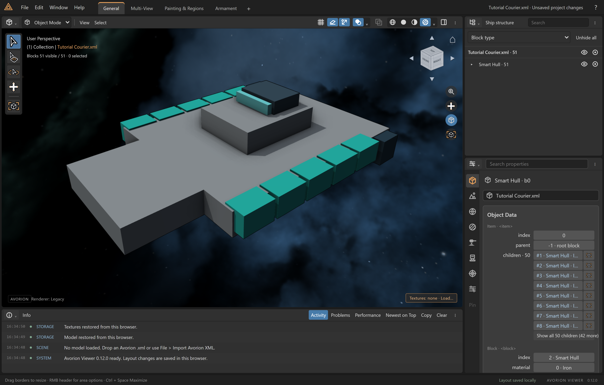

# User Interface

The interface is a set of editor areas inside one browser window. Workspaces organize those areas; headers, toolbars, sidebars, tabs and panels organize controls within each area.

## Read the screen

1. **Topbar:** application menus and workspace tabs.
2. **Areas:** independently sized editors such as 3D Viewport, Outliner or Properties.
3. **Regions:** an editor's header, toolbar, content and optional sidebar.
4. **Status Bar:** contextual hints, activity and application version.

Start with Window System for the overall model. The remaining pages explain each part of the interface in detail.
