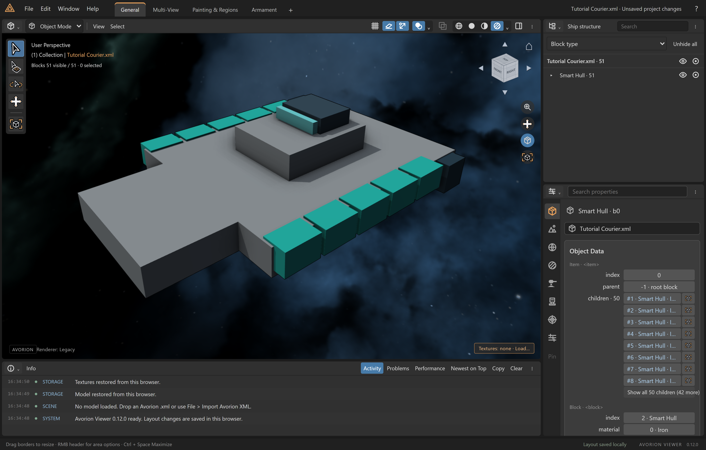

# Window System

Avorion Viewer uses a Blender-inspired system of tiled editors. These are areas of the web application, not separate operating-system windows. A workspace holds a layout of areas; an area displays one editor.

## Shared model, independent views

All viewports show the same loaded ship. Painting, visibility and selection affect the shared model. Each viewport can have its own camera, shading and overlay settings. Adding a second viewport does not load a second ship.

## Arrange your workspace

Use [Areas](../areas/) to resize, split, join or swap editors. Use [Workspaces](../workspaces/) to save several arrangements for inspection, painting and armament. Use the editor selector in an area header to change its editor type.

## Try the window system

Drag the actual dividers, double-click to equalize, or use the area menu to split, join, swap or maximize. The editor selector changes an area's type. Corner grips support splitting and joining; Ctrl-dragging to another area swaps editors. Focus a divider and use arrow keys for keyboard resizing.

:::{raw} html
<iframe class="manual-window-frame" src="../_static/window-demo.html" title="Interactive window system: drag, split, join and switch editors" loading="lazy"></iframe>
:::

The example uses the app's shared layout and divider modules. Its editor contents are lightweight illustrations, and its changes stay inside the example. It does not save a workspace, alter your ship or access your browser's model storage. **Reset example** restores the initial layout.

If the embedded example is unavailable, the [Areas](../areas/) chapter provides the same gestures and commands as written instructions.

## Recover a layout

Press **Escape** to cancel an unfinished gesture. Restore a maximized area before splitting or joining. Use **Window > Reset current workspace** to return to its default arrangement. Keep an exported Workspace Profile before large layout experiments.
