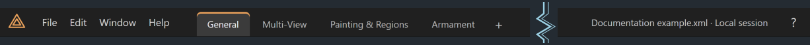
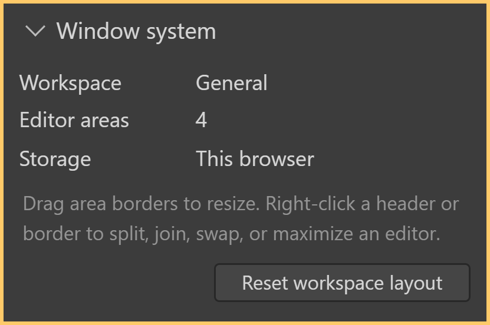

# Workspaces

A workspace stores an arrangement of editor areas and their settings. Different workspaces can suit inspecting construction, comparing views, painting, or arranging armament.

The blueprint break line marks omitted empty spacing; the original bar is continuous.

## Switch and create

Select a workspace tab in the topbar. The **+** control creates a workspace from an available arrangement. Default names can differ from an older saved layout.

## Rename, duplicate and remove

Double-click a tab to rename it, or use its context menu. Duplicate a workspace before experimenting with its arrangement. At least one workspace must remain. Removing a workspace removes its arrangement, not a separate copy of the shared ship.

## Reset and persistence

<!-- inline-capture:workspaces-workspace-settings-window-system-64 -->
:::{raw} html
<figure class="section-control-image"><figcaption>Workspace settings · Window system</figcaption></figure>
:::
<!-- end-inline-capture -->

**Window > Reset current workspace** restores its preset arrangement. **Save workspace layout locally** keeps the arrangement in this browser when layout persistence is enabled. Export a [Workspace Profile](../workspace-profile/) to move settings between browsers.

## Compare views

Multiple viewports share model data but can use different cameras and display settings. Use an orthographic overview beside a perspective detail view. Changes to paint or attachments still affect the same model.
